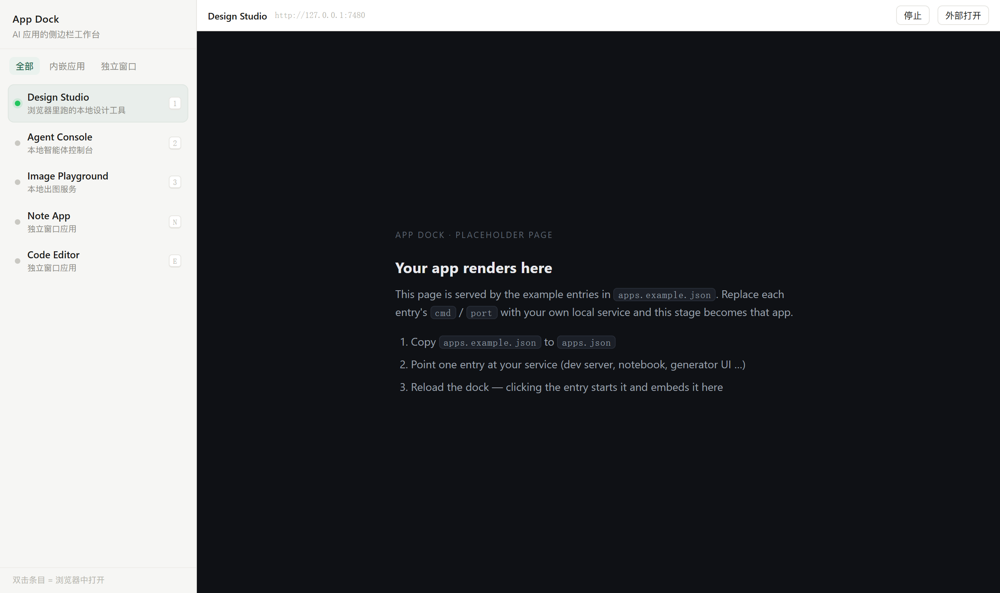

# AI Desktop Ops

**中文名：AI 桌面运维台 —— 把本机 AI 软件应用清单，固定成桌面应用侧边栏里的常驻工作台。**

你在本机装了一堆 AI 工具 —— 出图服务、Agent 控制台、向量库前端、本地 IDE、标注工具、生成器 UI。
它们各自跑在自己的端口上，每次用都要翻书签、记端口、开终端 `npm run dev`。

AI Desktop Ops 把这堆东西收成侧边栏里的**一列条目**：

- 绿点 = 在跑，灰点 = 没跑
- 点一下 → 没跑的先拉起，起好自动嵌进右侧舞台
- 独立窗口的 AI 应用（本地 IDE、Electron 客户端）也收：点一下就把它拉起来，不嵌 iframe
- 侧栏常驻、不可折叠，关掉了 6 秒内自己回来

它不绑定任何具体应用：**应用清单是一份 JSON**，你写什么它就显示什么。

### 一条规则：装了、能开独立窗口的 AI 应用，就该在侧栏有一行

这条是本项目的验收标准。不管是本地出图服务、Agent 控制台，还是只能开自己窗口的桌面客户端，
装在本机又真能跑起来，就应该在侧栏出现——**「它没有端口」「它不能被 iframe 嵌」都不是排除理由**。

判定只看事实：有可见顶层窗口 → `kind:"native"`（只拉起、不内嵌）；有端口能通 → `kind:"web"`
（可内嵌）；只在硬盘上躺着、从没跑出过窗口 → 先不收。

```powershell
python tools/list-windows-apps.py          # 现在真开着窗口的应用：exe / pid / 标题
python tools/list-windows-apps.py --json   # 直接可粘进 apps.json 的条目（路径已换成占位变量）
```

脚本走 Win32 枚举（`IsWindowVisible` + 反查 pid → exe 完整路径），不扫开始菜单——**装着不算证据，
此刻有窗口才算**。系统壳窗口、控制台宿主、宿主自己由脚本默认滤掉；排除项与细节见
[`SKILL.md`](SKILL.md)。




> 左：舞台内嵌正在运行的应用。右：贴在窄侧栏里的形态（252px 宽）。
> 两张图用的都是仓库自带的示例清单 `apps.example.json`，不含任何真实软件名。

---

## 它到底是什么

三个小零件，职责严格分开：

| 零件 | 文件 | 干什么 |
|---|---|---|
| **Hub** | `hub/hub.py` | 本机一个 HTTP 服务（默认 `127.0.0.1:7777`）。读 `apps.json`、探端口活、拉起/停止进程、吐 JSON 状态、自带一个独立可用的完整页面 `hub/index.html` |
| **Plugin** | `plugin/plugin.js` | 宿主桌面应用里的侧栏面板。只做三件事：拉状态、渲染条目、把选中的 web 应用内嵌进舞台 |
| **Registry** | `hub/apps.json` | 你的应用清单。存盘即热加载，不用重启 |

关键点：**插件前端没有 exec/spawn 权限，所以"启动"永远是 POST 给 hub**。
能力边界写在架构上，而不是靠代码自觉。

---

## 30 秒跑起来（Windows，只用标准库）

```powershell
git clone <this-repo> ai-desktop-ops
cd ai-desktop-ops\hub
copy apps.example.json apps.json
python hub.py
```

打开 <http://127.0.0.1:7777> —— 左栏就是工作台，点 `Design Studio` 会真的起一个静态服务并嵌进右边。

- 只要 Python 3.8+，**零第三方依赖**（`json/os/re/shutil/socket/subprocess/threading/http.server`）
- 默认只监听 `127.0.0.1`，局域网访问不到
- 冷启第一次 `/api/state` 约 1–2 秒（要探 5 个端口），稳态 ~45ms

> 示例清单里有两条 `kind:"native"`（独立窗口程序），它们的 `exe` 是**虚构占位路径** ——
> 你机器上并没有 `NoteApp.exe` / `CodeEditor.exe`，所以它们显示灰点、点了会提示「程序文件不存在」。
> 这是预期行为（用来演示 `exists:false` 长什么样），换成你自己的程序路径就活了。

---

## 装进宿主桌面应用的侧边栏

宿主只要支持「加载本地 JS 插件 + 声明一个侧栏面板」，就能装。以 **Hermes Agent** 为例：

```
%LOCALAPPDATA%\hermes\desktop-plugins\ai-desktop-ops\plugin.js   ← 把 plugin/plugin.js 放这里
```

重启宿主 → 右侧出现「工作台」面板。面板默认 252px 宽，可以拖宽，拖动后内嵌的应用也跟着变宽。

其它宿主（Electron 系）适配要点见 [`docs/INSTALL.md`](docs/INSTALL.md)。插件对外只依赖宿主的 4 个能力：

```js
ctx.register({ id, area: 'panes', title, render, data: { placement, width, collapsible } })
host.paneVisibility(scopedId)   // 可选：拿面板可见性
host.undismissPane(scopedId)    // 可选：把被关掉的面板叫回来
host.os.openExternal(url)       // 可选：浏览器打开
```

后三个都是**可选**的：没有就降级，不会崩。

---

## 写你自己的清单

`hub/apps.json` 是个数组，一条 = 一个应用：

```json
{
  "id": "image-playground",
  "name": "Image Playground",
  "sub": "本地出图服务",
  "kind": "web",
  "group": "内嵌应用",
  "port": 7482,
  "cwd": "{HERE}/../examples/site",
  "cmd": "{PY} -m http.server {port} --bind 127.0.0.1",
  "hotkey": "3"
}
```

| 字段 | 必填 | 说明 |
|---|---|---|
| `id` | ✅ | 唯一标识，用在 `/api/start/<id>` 和 URL 里 |
| `name` | ✅ | 侧栏显示的名字 |
| `kind` | ✅ | `web`（有端口，可内嵌）或 `native`（独立窗口程序，只拉起不内嵌） |
| `sub` | | 副标题，一行灰字 |
| `group` | | 分组，侧栏顶部的 tab 按它自动生成 |
| `port` | web 必填 | 端口通了就算"在跑" |
| `url` | | 覆盖默认 `http://127.0.0.1:<port>` |
| `cwd` | | 启动工作目录 |
| `cmd` | web 必填 | 启动命令，支持占位变量 |
| `exe` | native 必填 | 可执行文件绝对路径（同样支持占位变量） |
| `hotkey` | | 单个字符，`1`–`9` / `a`–`z`，渲染成条目右侧的徽标（由 `/api/state` 带出，宿主可自行映射成快捷键） |

### 占位变量（这样清单才能跨机器用）

绝对路径一律写占位，换台机器不用改：

| 占位 | 展开成 |
|---|---|
| `{HERE}` | hub 所在目录 |
| `{HOME}` | 用户主目录 |
| `{APPDATA}` | `…\Roaming` |
| `{LOCALAPPDATA}` | `…\Local` |
| `{PROGRAMFILES}` | `C:\Program Files` |
| `{PROGRAMFILES_X86}` | `C:\Program Files (x86)` |
| `{PROGRAMDATA}` | `C:\ProgramData` |
| `{PY}` | 当前 Python 解释器 |
| `{id}` `{name}` `{port}` `{url}` `{exe}` | 该条目自己的字段 |

```json
"exe": "{PROGRAMFILES}\\Some Editor\\Some Editor.exe"
```

字段全表、常见写法（Vite/Next/uvicorn/JupyterLab/Electron 应用）见 [`docs/CONFIG.md`](docs/CONFIG.md)。

---

## HTTP API

Hub 就 6 个端点，方便你自己接：

| 方法 | 路径 | 作用 |
|---|---|---|
| GET | `/` | 完整工作台页面（左栏 + 舞台） |
| GET | `/api/state` | `{apps: [{id,name,kind,alive,exists,port,url,group,sub,hotkey}]}` |
| POST | `/api/start/<id>` | 拉起。返回 `{ok,msg:"已拉起" / "已在运行"}` |
| POST | `/api/stop/<id>` | 停止（只停登记过的那个进程） |
| GET | `/api/ping` | 自检探针，把这次访问追加到 `logs/plugin-alive.txt` |
| GET | `/api/health` | `{ok:true,n:<条目数>}` |

环境变量：`WB_PORT`（默认 7777）、`WB_HOST`（默认 `127.0.0.1`）、`WB_APPS`（清单路径）、`WB_LOGDIR`（日志目录）。

> 想验证"插件到底加载了没有、面板真的渲染了吗"，看 `logs/plugin-alive.txt`：
> 只有 `pane=1&n=<条数>` 那一行才证明面板渲染并成功跨源取到了数据。

---

## 三个设计取舍

**1. 为什么不把启动逻辑写进插件？**
插件跑在渲染进程里，给它 spawn 能力等于把宿主变成提权后门。放 hub 里，能力边界是一个可审计的本地 HTTP 服务（6 个端点），而不是一段跑在你界面里的任意代码。

**2. 为什么内嵌用裸 `<iframe>`？**
宿主 SDK 常提供一个"沙箱 iframe"组件，它会剥掉 `allow-same-origin`。结果：guest 变成 opaque origin，Vite/React 这类 SPA 一 `localStorage.getItem` 就抛 `SecurityError`，白屏。
所以这里用裸 iframe，不加 `sandbox`。代价是 guest 与宿主同源信任级别 —— 只嵌你自己本机跑的服务，别嵌外网站。

**3. 为什么要"看门狗"？**
"常驻侧栏"不是画个 `collapsible:false` 就完事：面板仍可能被快捷键关掉、被布局重置吞掉。所以每 6 秒检查一次可见性，不可见就 `undismissPane()` 叫回来。常驻是行为，不是样式。

更多细节见 [`docs/ARCHITECTURE.md`](docs/ARCHITECTURE.md)。

---

## 安全

- Hub **只监听 `127.0.0.1`**。不要改成 `0.0.0.0` —— 它按 `apps.json` 起进程，暴露到网络等于给局域网一个命令执行口。
- `cmd` / `exe` 来自你自己的清单，等于你自己的启动脚本，hub 不做白名单。**不要用别人给的 `apps.json`。**
- 示例清单里的命令只有 `python -m http.server`，没有任何联网或写盘动作。
- 仓库不含任何凭据、token、密钥；`.env` 与 `logs/` 已在 `.gitignore` 里。

---

## 目录

```
ai-desktop-ops/
├─ hub/
│  ├─ hub.py              # 服务端：清单 / 探活 / 启动 / JSON + 页面
│  ├─ index.html          # 独立可用的完整工作台页面
│  └─ apps.example.json   # 占位示例清单（复制成 apps.json 用）
├─ plugin/
│  └─ plugin.js           # 宿主侧栏面板
├─ examples/
│  └─ site/index.html     # 示例 web 应用（被示例清单起的静态页）
├─ docs/
│  ├─ INSTALL.md          # 装进宿主 / 其它 Electron 宿主适配
│  ├─ CONFIG.md           # apps.json 字段全表 + 常见写法
│  ├─ ARCHITECTURE.md     # 为什么这么切分
│  └─ screenshots/
├─ SKILL.md               # 也能当 agent skill 加载（见下）
├─ install.ps1            # Windows 一键落盘（不含自启，需 -Autostart 显式开启）
└─ LICENSE                # MIT
```

---

## 也能当 agent skill 用

`SKILL.md` 把这个仓库写成一份可被 AI agent 加载的技能：给它一个"把本地 AI 应用收进侧栏"的活，它会读这份技能、按步骤建 `apps.json`、起 hub、装插件。
不做 AI 也完全不影响使用 —— 那只是一个 Markdown 文件。

---

## License

MIT。
